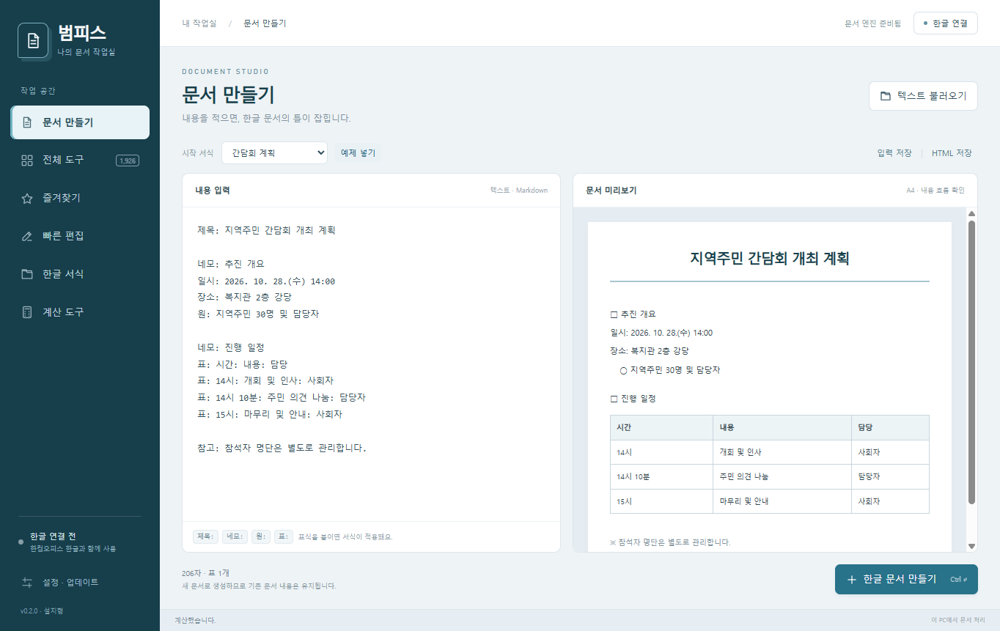

# 범피스 작업실

한컴오피스 한글과 함께 사용하는 Windows 문서 자동화 앱입니다. Electron 화면과 로컬 Python COM 엔진으로 구성되어 있습니다.



## 다운로드와 실행

[최신 버전 다운로드](https://github.com/kijung4290/beomdesk/releases/latest)

- `BeomDesk-버전-setup.exe`: 설치형. 설치 위치와 바로가기를 선택할 수 있습니다.
- `BeomDesk-버전-portable.exe`: 무설치형. 쓰기 가능한 폴더에 두고 실행하세요. 옆의 `BeomDeskData` 폴더에 설정·초안·작업 사본을 보관합니다.

한글 문서 작업에는 설치된 한컴오피스 한글이 필요합니다. 일부 원본 도구에는 Excel 또는 PowerPoint가 추가로 필요합니다. 입력·미리보기·HTML 저장·계산은 한글 연결 없이 사용할 수 있습니다. Python이나 Node.js를 별도로 설치할 필요는 없습니다.

## 사용 순서

1. **문서 만들기**에서 예제를 고르거나 텍스트를 작성합니다. `제목:`, `네모:`, `원:`, `표:` 표식과 Markdown 제목·목록·표를 사용할 수 있습니다.
2. **한글 문서 만들기**를 누르면 새 문서에 내용을 넣습니다. 기존 문서 내용은 덮어쓰지 않습니다.
3. **빠른 편집**은 한글에서 선택한 글자·문단·셀에 적용됩니다.
4. **전체 도구**에서 기관명·기능을 검색하고, 즐겨찾기를 지정합니다. 바로 실행할 수 있는 도구는 한글에 적용하고, 추가 입력이 필요한 도구는 원본 입력 화면을 엽니다.
5. **한글 서식**에서는 포함된 HWP/HWPX 27개를 복사하거나 작업 사본으로 열 수 있습니다.

단축키: `Ctrl+Enter` 문서 생성, `Ctrl+S` 입력 저장, `Ctrl+K` 도구 검색.

## 포함 기능과 구현 범위

- 새 Electron UI: 문서 입력·실시간 미리보기, 검색·분류·즐겨찾기, 글자·문단·표 빠른 편집, 서식 탐색, 날짜·금액 계산, 업데이트 관리.
- 원본의 버튼 연결 1,926개를 카탈로그로 제공합니다. 정적으로 식별 가능한 콜백은 새 UI에서 직접 실행하고, 사용자 입력과 지역 변수에 의존하는 콜백은 원본 화면을 사용합니다.
- 현재 직접 적용 가능한 연결은 1,747개입니다. 같은 기능이 여러 화면에 등장하는 항목도 포함된 수치입니다.
- 기존 한글 자동화의 세부 동작과 방대한 기관별 기능을 보존하기 위해 `assets/legacy`의 추출 Python 3.11 바이트코드를 호환 구성 요소로 사용합니다. 새 UI·문서 모델·COM 제어·콜백 해석·패키징·업데이트 코드는 이 저장소에 소스로 들어 있습니다.
- 원본 `메인` 모듈 전체를 실행하지 않습니다. 필요한 함수 정의만 연결하므로 원본 시작 코드의 `gen_py` 캐시 삭제는 수행하지 않습니다.
- 디컴파일 결과의 2,905개 코드 조각을 그대로 실행 가능한 완성 소스라고 취급하지 않습니다. 원본 구성 요소까지 모두 처음부터 재작성한 제품은 아닙니다.

## 자동 업데이트

공개 GitHub Releases `kijung4290/beomdesk`를 사용합니다.

- 설치형: `electron-updater`가 `latest.yml`과 설치 파일을 확인합니다. 다운로드 완료 후 사용자가 다시 시작할 때 NSIS 업데이트를 적용합니다.
- 무설치형: `portable-latest.json`의 버전·크기·SHA-512로 새 EXE를 검증한 후, 앱 종료 뒤 원래 실행 파일을 교체하고 다시 실행합니다. 이전 파일은 `.previous`로 보관합니다. 설정과 초안 폴더는 유지합니다.
- 업데이트는 시작 시 확인하고 새 버전을 백그라운드에서 다운로드합니다. 적용은 사용자가 **업데이트 후 다시 시작**을 눌렀을 때 진행합니다. **설정 · 업데이트**에서 자동 확인·다운로드 설정을 변경할 수 있습니다.
- 다운로드가 변조되거나 끝나지 않으면 적용하지 않습니다. 네트워크 장애는 앱의 문서 기능을 막지 않습니다.

초기 0.2.0·0.2.1 배포본은 최신 설치 파일 또는 무설치 파일을 직접 내려받아 교체해 주세요. 무설치형의 `BeomDeskData` 폴더는 그대로 보관하세요.

현재 배포물은 Windows 코드 서명 인증서로 서명하지 않습니다. Windows에서 게시자 확인 또는 SmartScreen 안내가 표시될 수 있습니다.

## 소스에서 실행

Windows x64, Node.js 24 이상, Python 3.11(Tkinter 포함)이 필요합니다.

```powershell
npm ci
python -m pip install -r requirements-build.txt
python build_backend.py
npm start
```

테스트와 패키징:

```powershell
python -m unittest discover -s tests -p "test_*.py" -v
npm test
npm run test:electron
npm run build
```

`.tools/python311`에 준비된 독립형 런타임을 사용하는 개발 환경에서는 `python` 대신 해당 폴더의 `python.exe`를 지정할 수 있습니다. 일반 설치 환경이나 GitHub Actions에는 이 폴더가 필요하지 않습니다. `prepare_runtime.py`는 최초 로컬 분석 환경용 보조 스크립트이며 CI 빌드의 필수 단계가 아닙니다.

## 새 버전 배포

`package.json`과 `package-lock.json`의 버전을 올리고 테스트한 뒤 `v버전` 태그를 푸시하면 GitHub Actions가 설치형·무설치형과 두 업데이트 메타데이터를 같은 릴리스에 올립니다. 앱·설치 파일·메타데이터의 버전을 동일하게 유지해야 합니다.

로컬에서 만든 릴리스를 게시할 때도 `npm run build`가 생성한 `.exe`, `.blockmap`, `latest.yml`, `portable-latest.json`, `SHA256SUMS.txt`를 함께 올리세요. 무설치형의 이름과 해시는 `scripts/release-manifest.cjs`가 생성합니다.

## 구조

```text
renderer/             Electron 화면과 사용자 흐름
electron/             IPC, 엔진 프로세스, 파일 대화상자, 업데이트
backend.py            로컬 JSON-lines 서비스 / Tk·COM 주 스레드
beomdesk/document.py  문서 파서와 HTML 출력
beomdesk/hwp.py       새 한글 자동화 코드
beomdesk/actions.py   원본 콜백의 제한된 AST 해석
beomdesk/legacy.py    추출 구성 요소와 원본 화면 연결
assets/               도구 목록, 원본 이미지·서식·호환 바이트코드
tests/, tests-js/     문서·계산·콜백·업데이트 검사
scripts/              Electron 실제 실행 검사 및 릴리스 생성
```

## 검증의 범위

실제 설치된 한글에서 새 테스트 문서의 문장·표 생성, 글꼴 적용, 호환 라이브러리의 문장 입력, 직접 적용 도구, 표 도구 화면, HWPX 저장을 검증했습니다. Electron 화면의 검색·즐겨찾기·계산·문서 미리보기·최소 창 크기·종료 직전 초안 보관도 검사했습니다. [검증 기록](docs/validation/electron-smoke.json), [한글 통합 검사](docs/validation/hwp-integration.json)를 참고하세요.

원본의 1,926개 개별 도구를 모두 실행하거나 모든 한글·Office 버전 조합을 검증한 것은 아닙니다.

원본에서 추출한 자료와 호환 바이트코드는 별도 원본 구성 요소입니다. 이 저장소에서 별도의 라이선스를 새로 부여하지 않습니다.
